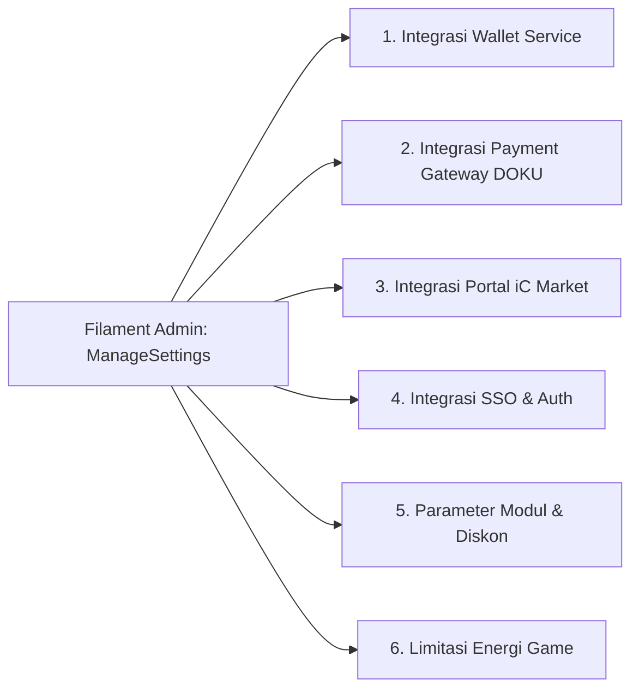

# Product Requirements Document (PRD): Strategi Bisnis, Modul Alur Belajar & Ekosistem Game-Z
**Versi Dokumen:** 3.2 (Edisi Standar Mutakhir - Dynamic Microservices Hub & Dual-Rail Payment)  
**Status:** Approved & Living Blueprint  
**Pemilik Produk:** Product Owner, System Analyst, Curriculum Engineer, Backend & Frontend Engineers  
**Target Platform:** Web (Desktop & Mobile Responsive)

---

## 1. Ringkasan Eksekutif (Executive Summary)

**iC Game-Z** adalah platform gamifikasi edukasi pemrograman dan rekayasa perangkat lunak modern. Fitur **Alur Belajar (Learning Path)** adalah produk inti (*core product*) yang memfasilitasi perjalanan belajar terstruktur dari *Novice* hingga *Boss Coder*.

Dokumen PRD V3.2 ini menyempurnakan arsitektur sistem dengan dua pilar utama:
1. **Dynamic Microservices & Ecosystem Hub di Panel Admin Filament:**  
   Seluruh *service* kecil penunjang Game-Z (Microservice Wallet iCoinZ, Payment Gateway DOKU, Portal iC Market, dan SSO Auth) serta parameter bisnis gamifikasi dikelola secara **100% dinamis** melalui panel admin Filament tanpa ketergantungan *hardcoded file environment* (.env).
2. **Dual-Rail Payment Architecture:**
   - **Modul Satuan (Eceran) via iCoinZ (c):** Pembelian modul alur belajar menggunakan mata uang virtual game (**iCoinZ**) melalui integrasi *Microservice Wallet*. Jika saldo iCoinZ kurang, sistem memicu pop-up cerdas yang mengarahkan user ke URL Top-Up iC Market dinamis.
   - **Paket Langganan (PRO & EXPERT) via DOKU Payment Gateway (Rupiah / IDR):** Pembelian paket langganan diproses resmi menggunakan mata uang Rupiah via gateway pembayaran **DOKU** melalui `ic-service-payment-gateway`.
   - **Bonus Reward iCoinZ Dinamis:** Admin dapat menentukan bonus iCoinZ yang diterima user saat membeli paket langganan via DOKU.
3. **Mekanisme Diskon Multi-Beli Modul:** Diskon instan **25%** dari total harga iCoinZ untuk pembelian $\ge 2$ modul sekaligus.
4. **Paket Berlangganan Berjenjang:**
   - **Paket PRO (Rp 49.999 / bulan):** Akses bebas memilih hingga **12 modul** per bulan (*irreversible claim*) + Challenge akses + Bonus iCoinZ.
   - **Paket EXPERT:** Akses tak terbatas (*Unlimited All Access*) ke seluruh alur belajar (19+ modul) + fitur VIP + Bonus iCoinZ.
5. **Keamanan Transaksi & UX State Lock:** Pencegahan *double spending*, *race condition*, dan penerapan *controlled delay* pada saat proses pembayaran.
6. **Resolusi Bug Leaderboard & HUD:** Pemulihan sinkronisasi peringkat podium untuk pengguna dengan 0 XP serta koreksi data HUD "XP Anda Saat Ini".

---

## 2. Struktur Produk & Matriks Hak Akses (Entitlement Matrix)

Sistem membedakan secara tegas antara hak akses terhadap materi pembelajaran (*Learning Paths*) dengan hak akses terhadap fitur kompetitif (*Challenges, Events, Leaderboard*), serta membedakan rel pembayaran (*payment rail*).

### 2.1. Tabel Komparasi Hak Akses, Fitur, & Metode Pembayaran

| Fitur / Parameter | Free User | Modul Satuan (Eceran) | Paket PRO | Paket EXPERT |
| :--- | :--- | :--- | :--- | :--- |
| **Harga** | Gratis (Rp 0) | **14,999c** *(Dinamis CMS)* | **Rp 49.999** / bulan | Sesuai Plan (Rupiah) |
| **Metode Pembayaran** | N/A | **Hanya iCoinZ (c)** *(Wallet)* | **DOKU Gateway** *(Fiat / IDR)* | **DOKU Gateway** *(Fiat / IDR)* |
| **Bonus iCoinZ Pengguna** | 0c | 0c | **Configurable via CMS** | **Configurable via CMS** |
| **Akses Modul Dasar (Free)** | ✅ Terbuka | ✅ Terbuka | ✅ Terbuka | ✅ Terbuka |
| **Akses Modul Premium** | ❌ Terkunci | ✅ **Modul yang dibeli saja** | ✅ **Pilih 12 Modul Bebas** | ✅ **Semua Modul (19+)** |
| **Masa Aktif Akses Modul** | Permanen | **30 Hari** *(Dinamis CMS)* | **30 Hari** (Mengikuti Plan) | Mengikuti Masa Aktif Plan |
| **Akses Global Challenge** | ❌ Terkunci | ❌ **Terkunci** | ✅ Terbuka | ✅ Terbuka |
| **Partisipasi Event & Trophy** | ❌ Terkunci | ❌ **Terkunci** | ✅ Terbuka | ✅ Terbuka (VIP Prioritas) |
| **Podium & Leaderboard Aktif** | ❌ Hanya pantau | ❌ Hanya pantau | ✅ Berhak Masuk Podium | ✅ Berhak Masuk Podium |
| **Status Akun (`is_premium`)** | `false` | `false` | `true` | `true` |
| **Batas Energi Harian** | 10 Energi *(CMS)* | 10 Energi | 20 Energi *(CMS)* | 25 Energi *(CMS)* |
| **Sifat Klaim Modul** | N/A | Transaksi iCoinZ Sukses | **Permanen / Irreversible** | Otomatis Terbuka Semua |

---

## 3. Aturan Bisnis & Logika Diskon (Business Rules)

### 3.1. Pembelian Modul Satuan (GameZ Shop via iCoinZ)
- Mata uang pembelian modul satuan **hanya menggunakan iCoinZ (c)**.
- Harga dasar standar: **14,999 iCoinZ** per modul (dapat diubah dinamis oleh Admin melalui Filament).
- Masa aktif akses: Dinamis via panel admin Filament (default: **30 Hari** untuk menciptakan *urgency* belajar).

### 3.2. Formula Diskon Multi-Beli (Multi-Buy Discount $\ge$ 2 Modul)
Ketika pengguna membeli 2 atau lebih modul dalam satu transaksi di GameZ Shop:
- Sistem secara otomatis memotong harga total sebesar persentase diskon dinamis (default: **25%**).
- **Formula:**
  $$\text{Total iCoinZ} = \sum (\text{Harga Modul}) \times (1 - \frac{\text{Diskon \%}}{100})$$
- **Contoh Kalkulasi (Diskon 25%):**
  - **1 Modul:** $1 \times 14.999c = \mathbf{14.999c}$ (Tanpa diskon)
  - **2 Modul:** $(2 \times 14.999c) \times 0.75 = 29.998c - 7.499,5c = \mathbf{22.498c}$ *(Hemat 7.500c)*
  - **3 Modul:** $(3 \times 14.999c) \times 0.75 = 44.997c - 11.249,25c = \mathbf{33.748c}$ *(Hemat 11.249c)*

### 3.3. Kuota Paket PRO (12 Modul Pilihan via DOKU)
- Pengguna yang berlangganan paket PRO (Rp 49.999 via DOKU) mendapatkan hak memilih **12 modul alur belajar** secara bebas selama masa aktif 30 hari.
- **Aturan Klaim Irreversible (Tidak Dapat Dibatalkan):**
  Modul yang telah dipilih dan dikonfirmasi menggunakan kuota Pro **TIDAK BISA DITUKAR / DI-RESET** selama periode tersebut.
- **Modul ke-13 dan Seterusnya:**
  Jika kuota 12 modul telah habis:
  - Pengguna dapat membeli modul tambahan secara eceran di Shop menggunakan iCoinZ (14,999c), **ATAU**
  - Meng-upgrade langganan ke **Paket EXPERT**.

### 3.4. Matriks Pencegahan Bentrok (Conflict Prevention)
1. **User Memiliki Modul Satuan lalu Berlangganan PRO:**
   - Modul satuan yang sudah dibeli **TIDAK MEMOTONG** kuota 12 modul PRO pengguna. Kuota 12 modul PRO tetap utuh untuk modul-modul lain yang belum dimiliki.
2. **User PRO Aktif Mengunjungi Shop:**
   - Modul yang saat ini aktif melalui kuota PRO diberi label status: *"Aktif via Paket PRO"*.
   - User diberikan opsi membeli secara eceran menggunakan iCoinZ jika ingin memperpanjang akses modul tersebut setelah masa PRO berakhir.
3. **User EXPERT Mengunjungi Shop:**
   - Tombol pembelian modul dinonaktifkan dengan banner: *"Akun Expert Anda memiliki akses penuh ke seluruh alur belajar"*.
4. **Masa Berlaku Habis (Expired):**
   - Ketika paket PRO habis, modul yang dibuka melalui kuota PRO akan terkunci kembali, **kecuali** modul yang dibeli secara eceran dan masih dalam masa aktif 30 hari sejak tanggal pembelian ecerannya.

---

## 4. Arsitektur Pembayaran Dual-Rail (DOKU & iCoinZ)

```mermaid
flowchart TD
    subgraph RAIL_FIAT["Rail 1: DOKU Payment Gateway (Rupiah / Fiat)"]
        PlanChoice[Pilih Paket PRO / EXPERT] --> CheckoutDoku[Halaman Checkout DOKU]
        CheckoutDoku --> PayDoku[Bayar via QRIS / VA / Bank]
        PayDoku --> WebhookDoku[Webhook ic-service-payment-gateway]
        WebhookDoku --> ActivatePlan[Aktifkan Status is_premium & Kuota 12 Modul]
        WebhookDoku --> CheckReward{Ada Bonus iCoinz?}
        CheckReward -- Ya --> CreditReward[Deposit Bonus iCoinZ ke Wallet User]
    end

    subgraph RAIL_VIRTUAL["Rail 2: iCoinZ Internal Wallet (Virtual Currency)"]
        ModuleChoice[Pilih Modul Satuan di GameZ Shop] --> CheckCoinz{Saldo iCoinZ Cukup?}
        CheckCoinz -- Kurang --> PopUpMarket[Tampilkan Pop-Up: iCoinZ Kurang]
        PopUpMarket --> DynamicMarketURL["Redirect ke URL Market Dinamis CMS"]
        CheckCoinz -- Cukup --> LockUI[State Lock UI & Controlled Delay 1.5s]
        LockUI --> DebitWallet[POST ke URL Wallet Dinamis CMS]
        DebitWallet --> UnlockModule[Simpan ke user_learning_paths 30 Hari]
    end
```



### 4.1. Alur Modul Eceran (iCoinZ) & Penanganan Saldo Kurang
- Transaksi modul satuan diproses oleh endpoint internal GameZ Backend ke URL Microservice Wallet yang dikonfigurasi dinamis di CMS.
- Jika saldo pengguna `< Total Harga iCoinZ`, frontend menampilkan modal cyberpunk `InsufficientBalanceModal.vue`:
  - Menampilkan total tagihan iCoinZ, saldo saat ini, dan selisih koin yang dibutuhkan.
  - Tombol aksi utama: **`"Top Up iCoinZ di iC Market"`** yang secara dinamis mengambil link dari konfigurasi CMS backend (default: `https://market.icraftds.id/topup`).

### 4.2. Alur Paket Langganan (DOKU) & Reward Bonus iCoinZ
1. Pengguna memilih paket PRO atau EXPERT di halaman Pricing / Checkout.
2. Transaksi dikirim ke URL Microservice Payment Gateway dinamis yang memanggil API DOKU (menghasilkan QRIS / nomor Virtual Account).
3. Setelah pengguna membayar dan webhook DOKU terverifikasi:
   - Status langganan diaktifkan (`is_premium = true`, masa aktif 30 hari).
   - Kuota 12 modul dialokasikan pada akun user.
   - **Pemberian Reward Bonus iCoinZ:** Backend membaca nilai `plans.icoinz_reward`. Jika nilainya $> 0$, sistem memanggil endpoint `POST /api/internal/credit` pada service wallet untuk menambahkan saldo iCoinZ tersebut ke akun user sebagai bonus pembelian paket!

---

## 5. Pusat Konfigurasi Dinamis di Admin Panel Filament (`ManageSettings.php`)

Seluruh service kecil dan integrasi penunjang Game-Z dikelompokkan ke dalam menu terpusat **Pengaturan Sistem (ManageSettings)** di Filament Admin:



### 5.1. Komponen Formulir Pengaturan Dinamis

```php
// app/Filament/Pages/ManageSettings.php
Section::make('Integrasi Microservice Wallet (iCoinZ)')
    ->description('Konfigurasi koneksi ke Microservice Wallet untuk transaksi iCoinZ.')
    ->schema([
        TextInput::make('wallet_service_url')
            ->label('Base URL Wallet API')
            ->placeholder('https://ic-wallet.unikom.my.id/api')
            ->required(),
        TextInput::make('wallet_internal_key')
            ->label('Internal Token / Secret Key')
            ->password()
            ->revealable()
            ->required(),
    ])->columns(2),

Section::make('Integrasi Microservice Payment Gateway (DOKU)')
    ->description('Konfigurasi koneksi ke Payment Gateway Service untuk pembayaran fiat/Rupiah.')
    ->schema([
        TextInput::make('payment_service_url')
            ->label('Base URL Payment Gateway API')
            ->placeholder('https://ic-pg.unikom.my.id/api')
            ->required(),
        TextInput::make('payment_internal_key')
            ->label('Internal Secret Token')
            ->password()
            ->revealable(),
    ])->columns(2),

Section::make('Integrasi Portal iC Market & Top Up')
    ->description('Tautan tujuan pengguna saat melakukan top-up iCoinZ.')
    ->schema([
        TextInput::make('market_topup_url')
            ->label('URL Halaman Top-Up iC Market')
            ->default('https://market.icraftds.id/topup')
            ->required(),
        Toggle::make('market_redirect_enabled')
            ->label('Aktifkan Redirection Top-Up')
            ->default(true),
    ])->columns(2),

Section::make('Integrasi SSO & Autentikasi')
    ->description('Konfigurasi layanan single sign-on akun terpusat.')
    ->schema([
        TextInput::make('sso_url')
            ->label('Base URL SSO')
            ->placeholder('https://ic-auth.unikom.my.id')
            ->required(),
        TextInput::make('sso_client_id')
            ->label('OAuth Client ID'),
    ])->columns(2),

Section::make('Parameter Bisnis Modul Alur Belajar & Toko')
    ->description('Aturan harga dasar, diskon multi-beli, dan durasi akses modul sewa.')
    ->schema([
        TextInput::make('module_default_price')
            ->label('Harga Flat 1 Modul (iCoinZ)')
            ->numeric()
            ->default(14999)
            ->required(),
        TextInput::make('module_multibuy_discount_percent')
            ->label('Diskon Beli >= 2 Modul (%)')
            ->numeric()
            ->default(25)
            ->suffix('%')
            ->required(),
        TextInput::make('module_default_duration_days')
            ->label('Durasi Masa Aktif Modul (Hari)')
            ->numeric()
            ->default(30)
            ->suffix('Hari')
            ->required(),
        TextInput::make('pro_max_selectable_modules')
            ->label('Kuota Modul Bebas Paket PRO')
            ->numeric()
            ->default(12)
            ->required(),
    ])->columns(2),

Section::make('Limitasi Energi & Gamifikasi')
    ->description('Atur maksimal energi mingguan pengguna.')
    ->schema([
        TextInput::make('max_free_energy')->label('Energi Free')->numeric()->default(10),
        TextInput::make('max_pro_energy')->label('Energi Pro')->numeric()->default(20),
        TextInput::make('max_expert_energy')->label('Energi Expert')->numeric()->default(25),
    ])->columns(3),
```

### 5.2. Service Helper Terpusat (`SystemSettingHelper`)
Agar backend dan job worker tidak membaca nilai *hardcoded*, seluruh komponen memanggil helper dinamis:
```php
// Mengambil konfigurasi dinamis dari database (fallback ke .env)
$walletUrl = SystemSetting::get('wallet_service_url', config('services.wallet.url'));
$marketTopUpUrl = SystemSetting::get('market_topup_url', 'https://market.icraftds.id/topup');
$modulePrice = SystemSetting::get('module_default_price', 14999);
$discountPct = SystemSetting::get('module_multibuy_discount_percent', 25);
```

### 5.3. Public Config Endpoint untuk Frontend
Disediakan endpoint publik ringan:
`GET /api/system/public-config`
Mengembalikan payload dinamis yang dikonsumsi oleh aplikasi Vue.js:
```json
{
  "market_topup_url": "https://market.icraftds.id/topup",
  "module_default_price": 14999,
  "module_multibuy_discount_percent": 25,
  "module_default_duration_days": 30,
  "pro_max_selectable_modules": 12
}
```
Dengan skema ini, jika Admin mengubah harga modul menjadi 9.999c atau mengubah link top up di Filament, aplikasi Frontend langsung mengikuti secara instan tanpa perlu *re-build* atau deploy ulang kode!

---

## 6. Spesifikasi Teknis Frontend (UX & Keamanan Antarmuka)

### 6.1. Mekanisme "Payment State Lock" (Pencegahan Double Spending)
Untuk menghindari *race condition* dan klik ganda (*double click*) pada saat pembayaran modul:
1. **Freeze Seluruh Interaksi Antarmuka:**
   - Elemen tombol aksi (`Beli Modul`, `Klaim Kuota Pro`), navigasi tab, tombol tutup modal, dan tombol *back* langsung di-disable menggunakan *directive* `disabled` dan style `pointer-events: none; opacity: 0.5`.
   - Backdrop modal dinonaktifkan dari aksi tutup saat diklik (*backdrop dismissal locked*).
2. **Terminal Loader / Cyber Lock Overlay:**
   - Menampilkan animasi status terminal:
     ```
     [LOCK] Mengamankan sesi transaksi...
     [WALLET] Mendebit iCoinZ melalui secure ledger...
     [SYNC] Mengaktifkan hak akses modul alur belajar...
     ```
3. **Controlled Delay (Latensi Terkontrol):**
   - Transaksi dibungkus menggunakan `Promise.all([apiCall, sleep(1500)])` dengan jeda minimal 1.500 ms untuk memberikan jeda aman antar microservice sebelum memperbarui antarmuka pengguna dan saldo di navbar.

---

## 7. Spesifikasi Teknis Backend & Basis Data

### 7.1. Skema Basis Data: `user_learning_paths`
Tabel relasional untuk mencatat modul alur belajar yang dimiliki pengguna (baik via eceran iCoinZ maupun klaim kuota Pro):

```sql
CREATE TABLE `user_learning_paths` (
  `id` BIGINT UNSIGNED NOT NULL AUTO_INCREMENT PRIMARY KEY,
  `user_id` BIGINT UNSIGNED NOT NULL,
  `learning_path_id` BIGINT UNSIGNED NOT NULL,
  `source_type` ENUM('direct_purchase', 'pro_quota') NOT NULL DEFAULT 'direct_purchase',
  `price_paid_icoinz` INT UNSIGNED NOT NULL DEFAULT 0,
  `reference_id` VARCHAR(100) NULL,
  `starts_at` DATETIME NOT NULL,
  `expires_at` DATETIME NOT NULL,
  `is_active` TINYINT(1) NOT NULL DEFAULT 1,
  `created_at` TIMESTAMP NULL,
  `updated_at` TIMESTAMP NULL,
  INDEX `idx_user_path_lookup` (`user_id`, `learning_path_id`, `is_active`, `expires_at`),
  CONSTRAINT `fk_ulp_user` FOREIGN KEY (`user_id`) REFERENCES `users` (`id`) ON DELETE CASCADE,
  CONSTRAINT `fk_ulp_path` FOREIGN KEY (`learning_path_id`) REFERENCES `learning_paths` (`id`) ON DELETE CASCADE
) ENGINE=InnoDB DEFAULT CHARSET=utf8mb4 COLLATE=utf8mb4_unicode_ci;
```

### 7.2. Perubahan pada Tabel `plans` (DOKU & Bonus iCoinZ)
```sql
ALTER TABLE `plans` 
  ADD COLUMN `icoinz_reward` INT UNSIGNED NOT NULL DEFAULT 0 AFTER `price`,
  ADD COLUMN `max_selectable_modules` INT UNSIGNED NOT NULL DEFAULT 0 AFTER `icoinz_reward`;
```
- `price`: Tetap dalam satuan **Rupiah** untuk transaksi DOKU (misal: `49999.00`).
- `icoinz_reward`: Nilai bonus iCoinZ yang diterima pengguna saat berhasil membeli paket langganan.
- `max_selectable_modules`: Kuota modul alur belajar yang dapat dipilih (untuk Pro diisi `12`, untuk Expert diisi `0` / unlimited).

### 7.3. Perubahan Tabel `system_settings`
```sql
ALTER TABLE `system_settings`
  ADD COLUMN `wallet_service_url` VARCHAR(255) NULL,
  ADD COLUMN `wallet_internal_key` VARCHAR(255) NULL,
  ADD COLUMN `payment_service_url` VARCHAR(255) NULL,
  ADD COLUMN `payment_internal_key` VARCHAR(255) NULL,
  ADD COLUMN `market_topup_url` VARCHAR(255) NULL DEFAULT 'https://market.icraftds.id/topup',
  ADD COLUMN `market_redirect_enabled` TINYINT(1) NOT NULL DEFAULT 1,
  ADD COLUMN `sso_url` VARCHAR(255) NULL,
  ADD COLUMN `sso_client_id` VARCHAR(255) NULL,
  ADD COLUMN `module_default_price` INT UNSIGNED NOT NULL DEFAULT 14999,
  ADD COLUMN `module_multibuy_discount_percent` INT UNSIGNED NOT NULL DEFAULT 25,
  ADD COLUMN `module_default_duration_days` INT UNSIGNED NOT NULL DEFAULT 30,
  ADD COLUMN `pro_max_selectable_modules` INT UNSIGNED NOT NULL DEFAULT 12;
```

### 7.4. Ringkasan API Endpoints Utama
1. `GET /api/system/public-config` — Mengembalikan konfigurasi publik (Market URL, harga modul, diskon) untuk dikonsumsi frontend.
2. `GET /api/shop/modules` — Mengambil daftar etalase alur belajar lengkap dengan status kepemilikan user saat ini.
3. `POST /api/shop/purchase-modules` — Memproses pembelian modul satuan menggunakan iCoinZ (diskon otomatis 25% jika $\ge 2$ modul).
4. `POST /api/subscription/claim-pro-module` — Memproses pemilihan modul alur belajar via kuota 12 paket Pro.
5. `GET /api/subscription/pro-quota` — Mengambil data kuota modul user Pro.

---

## 8. Spesifikasi Perbaikan Bug Leaderboard & HUD

### 8.1. Masalah Podium & Ranking 0 XP (Root Cause Analysis)
- **Gejala Bug:** Pengguna baru atau pengguna yang belum memiliki aktivitas apapun di bulan berjalan (0 XP) muncul di posisi #3, #2, atau bahkan #1 pada podium bulanan.
- **Penyebab:** 
  Pada method `rank()` di `LeaderboardService.php`, query menghitung posisi dengan:
  `DB::query()->fromSub($totals, 'xp_totals')->where('total_xp', '>', $xp)->count() + 1`.
  Ketika baru ada 2 orang pengguna aktif di awal bulan yang memiliki XP > 0, maka bagi seluruh pengguna lain yang XP-nya = 0, query menghasilkan `count() = 2`, sehingga peringkatnya dihitung sebagai `2 + 1 = 3`. Sistem kemudian menempatkan user 0 XP tersebut di Podium Juara 3.
- **Formulasi Perbaikan Backend:**
  1. Pada `LeaderboardService`:
     ```php
     if ($monthly && $xp <= 0) {
         return $this->getLastMonthlyRank(); // Kembalikan peringkat terbawah / unranked
     }
     ```
  2. Tambahkan filter pada query podium bulanan (`getMonthly`):
     ```php
     ->where('xp_transactions.created_at', '>=', now()->startOfMonth())
     ->havingRaw('SUM(xp_transactions.xp_amount) > 0')
     ```
  3. Pada frontend `LeaderboardTable.vue`, podium hanya dirender jika `user.xp > 0`. Jika peserta dengan XP > 0 kurang dari 3 orang, slot podium yang kosong menampilkan state edukatif *"Belum Ada Jawara - Kerjakan Challenge Sekarang!"*.

### 8.2. Masalah Teks HUD "TARGET XP ANDA"
- **Gejala Bug:** Kotak status HUD di atas tabel menampilkan label `"TARGET XP ANDA"`, namun nilai angkanya adalah nomor peringkat (bukan XP).
- **Formulasi Perbaikan Frontend:**
  - Ubah label HUD di `LeaderboardTable.vue` dari `"TARGET XP ANDA"` menjadi:
    - **`XP BULAN INI`** saat tab *Bulan Ini* aktif.
    - **`TOTAL XP ANDA`** saat tab *Sepanjang Masa* aktif.
  - Nilai yang ditampilkan wajib mengacu pada akumulasi XP riil user (`userMonthlyXp` atau `userProfile.xp`), lengkap dengan ikon Trophy / XP Glitch yang selaras.

---

## 9. Checklist Kriteria Penerimaan (Acceptance Criteria)

- [ ] Seluruh endpoint service penunjang (Wallet, Payment Gateway, iC Market Top-Up, SSO) dapat dikonfigurasi dinamis di panel Filament `ManageSettings`.
- [ ] Parameter bisnis (harga dasar modul, % diskon multi-beli, durasi sewa modul, kuota modul Pro) dapat diubah langsung oleh admin di CMS.
- [ ] Endpoint `GET /api/system/public-config` mengembalikan nilai dinamis yang langsung digunakan oleh frontend Vue.js.
- [ ] Pembelian modul satuan hanya dapat dibayar menggunakan saldo iCoinZ (14,999c per modul).
- [ ] Pembelian 2 atau lebih modul sekaligus otomatis mendapatkan diskon 25% dari total harga iCoinZ.
- [ ] Pengguna yang kekurangan saldo iCoinZ berhasil menampilkan pop-up dengan tombol redirect ke URL Market dinamis.
- [ ] Paket PRO dan EXPERT tetap diproses melalui payment gateway DOKU menggunakan mata uang Rupiah.
- [ ] Pembelian paket PRO / EXPERT via DOKU yang sukses secara otomatis mengkreditkan bonus iCoinZ sesuai konfigurasi admin pada tabel `plans`.
- [ ] Pengguna paket Pro dapat memilih hingga maksimal 12 modul dan pilihan tersebut bersifat permanen / irreversible.
- [ ] Pengguna paket Expert memiliki akses penuh ke seluruh alur belajar secara otomatis tanpa pembatasan kuota.
- [ ] Seluruh tombol dan navigasi terkunci (*freeze*) selama proses pembayaran berlangsung dengan jeda terkontrol ~1.5 detik.
- [ ] Pengguna dengan 0 XP pada bulan berjalan tidak muncul di podium atau menduduki peringkat atas.
- [ ] Label HUD pada Leaderboard menampilkan "XP ANDA SAAT INI" dengan nilai XP yang akurat.
