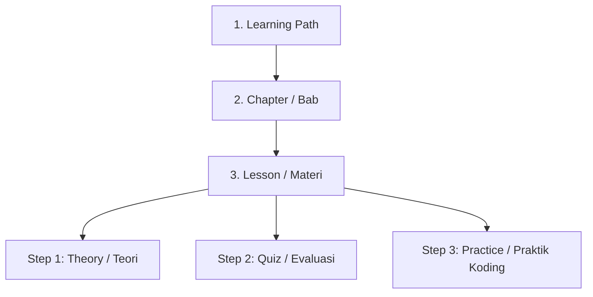
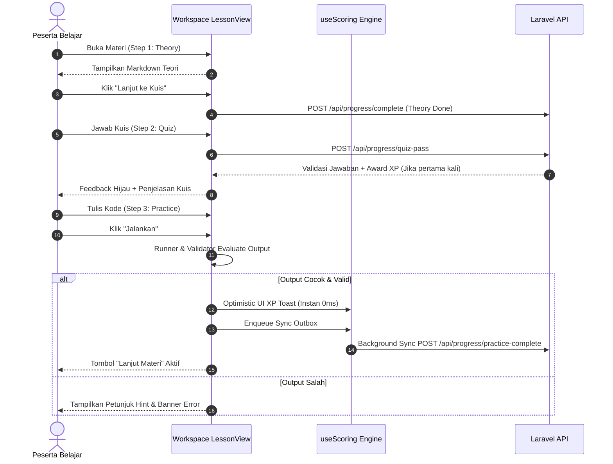

# Product Requirements Document (PRD): Alur Belajar & Modul Interaktif IC Game-Z
**Versi:** 2.0 (Edisi Standar Mutakhir 2026)  
**Status:** Approved & Living Document  
**Target Pengguna:** Content Creator, Curriculum Engineer, Backend & Frontend Developers

---

## 1. Ringkasan Eksekutif (Executive Summary)

Platform **IC Game-Z** adalah platform gamifikasi edukasi pemrograman dan teknologi. Fitur **Alur Belajar (Learning Path)** adalah produk inti (*core product*) yang memberikan panduan belajar terarah dari tingkat pemula (*Novice*) hingga mahir (*Expert/Boss*). 

PRD ini mendefinisikan standar arsitektur, skema data, engine validasi koding interaktif, gamifikasi, serta tata kelola konten melalui CMS Filament dan Database Seeder agar setiap alur belajar baru yang dikembangkan memiliki kualitas pedagogis tinggi, performa stabil, dan kompatibilitas sistem 100%.

---

## 2. Struktur Hierarki Pembelajaran

Sistem Alur Belajar IC Game-Z menerapkan hierarki data 5 level:



### 2.1. Level 1: Learning Path (Alur Belajar)
Entitas kurikulum tingkat teratas (Contoh: *Dasar Pemrograman*, *Database & SQL*, *PHP & Laravel*).
- **Atribut Utama:**
  - `title`: Judul alur belajar (maksimal 60 karakter).
  - `slug`: URL identifier unik (*kebab-case*, misal `database-sql`).
  - `description`: Ringkasan kompetensi yang akan dicapai peserta.
  - `icon`: Ikon FontAwesome 6 (misal `fa-solid fa-database`, `fa-brands fa-js`).
  - `is_premium`: Boolean (`true` jika hanya untuk user paket Pro/Premium, `false` jika gratis).
  - `sort_order`: Urutan indeks tampilan di katalog halaman Alur Belajar.

### 2.2. Level 2: Chapter (Bab Pembelajaran)
Pembagian logis dari sebuah alur belajar (biasanya terdiri dari 4 sampai 6 bab per path).
- **Atribut Utama:**
  - `learning_path_id`: Relasi ke Learning Path induk.
  - `title`: Judul bab (misal `Bab 1: Fundamental Database & Tabel`).
  - `slug`: URL identifier unik (misal `sql-bab-1-fundamental`).
  - `sort_order`: Urutan bab dalam roadmap.

### 2.3. Level 3: Lesson (Unit Materi)
Unit belajar tunggal yang diselesaikan pengguna dalam satu sesi.
- **Tipe Lesson (`type`):**
  - `theory_quiz_practice`: Standar utama alur belajar (terdiri dari 3 langkah berurutan: Teori -> Kuis -> Praktik Koding).
  - `theory`: Khusus materi konseptual/wawasan tanpa praktik koding langsung.
  - `code`: Khusus soal tantangan mandiri (*Global Challenges*).
- **Tingkat Kesulitan (`difficulty`):**
  - `easy`: Materi fundamental & pengenalan sintaks (+25 XP, +10 iCoinZ).
  - `medium`: Materi implementasi logika & manipulasi data (+50 XP, +10 iCoinZ).
  - `hard`: Studi kasus kompleks & optimasi (+100 XP, +15 iCoinZ).
  - `boss`: Ujian akhir bab / proyek mini (+300 XP, +25 iCoinZ).
- **Spesifikasi Engine:**
  - `language`: `javascript`, `sql`, `python`, `php`, `html`, `css`.
  - `validation_type`: `stdout`, `sql_result`, `dom`, `string_match`.
  - `setup_code`: Query DDL/DML untuk inisialisasi lingkungan khusus (opsional).
  - `cost_credit`: Jumlah energi yang dikonsumsi per pembukaan materi (standar: 1 credit untuk free user).

---

## 3. Spesifikasi Standar File JSON Materi

Setiap materi alur belajar disimpan dalam file JSON individual di folder `database/Alur Belajar/{slug-path}/{slug-chapter}/{order}-{slug-lesson}.json`.

### 3.1. Schema Format JSON Standar

```json
{
  "slug": "select-semua-kolom",
  "title": "SELECT Semua Kolom Tabel",
  "order": 1,
  "difficulty": "easy",
  "language": "sql",
  "validation_type": "sql_result",
  "setup_code": null,
  "content_markdown": "### Membaca Seluruh Data\n\n**What:** Perintah `SELECT *` digunakan untuk mengambil seluruh kolom dan baris pada sebuah tabel.\n\n**Why:** Sangat berguna ketika kita ingin melakukan inspeksi awal isi data secara menyeluruh.\n\n**How:**\n```sql\nSELECT * FROM products;\n```\n",
  "quizzes": [
    {
      "question": "Karakter apa yang digunakan untuk memilih semua kolom dalam SQL?",
      "options": [
        "Tanda bintang (*)",
        "Tanda pagar (#)",
        "Tanda persen (%)",
        "Tanda tanya (?)"
      ],
      "answer_index": 0,
      "explanation": "Karakter asterisk (*) bertindak sebagai wildcard untuk memilih seluruh kolom pada tabel.",
      "hint": "Lihat bagian How pada materi di atas."
    }
  ],
  "practice": {
    "title": "Praktik SELECT Semua Data",
    "instruction": "Tampilkan seluruh data pada tabel pelanggan!",
    "task_description": "Tuliskan query SQL untuk mengambil seluruh kolom dan data dari tabel `customers`.",
    "initial_code": "-- 🎯 Tulis query SQL Anda di bawah ini\n",
    "solution_code": "SELECT * FROM customers;",
    "hints": [
      "Gunakan perintah SELECT * FROM diikuti nama tabel customers."
    ],
    "required_keywords": ["SELECT", "FROM", "customers"],
    "restricted_keywords": ["DROP", "DELETE"],
    "test_cases": [
      {
        "input": "",
        "expected_output": "[{\"id\":1,\"name\":\"Andi Pratama\"},{\"id\":2,\"name\":\"Budi Santoso\"}]",
        "is_hidden": false,
        "description": "Output tabel customers lengkap"
      }
    ]
  }
}
```

---

## 4. Spesifikasi Engine Eksekusi & Validasi Workspace

Aplikasi web IC Game-Z mengusung lingkungan eksekusi kode sisi-klien (*Client-Side Sandboxed Engine*) yang instan tanpa ketergantungan server compile.

### 4.1. SQL Engine (`validation_type: sql_result`)
- **Teknologi:** In-memory SQLite compiled to WebAssembly (sql.js / SQLite3).
- **Dataset Toko Standar (IC Game-Z Store Dataset):**
  Engine secara otomatis menyediakan database e-commerce game & elektronik yang terdiri dari **12 Tabel Relasional**:
  1. `categories` (Kategori produk)
  2. `products` (Katalog barang game)
  3. `customers` (Data pelanggan)
  4. `orders` (Header transaksi)
  5. `order_items` (Rincian item pembelian)
  6. `payments` (Metode & status pembayaran)
  7. `shipping` (Logistik pengiriman)
  8. `coupons` (Voucher promo diskon)
  9. `product_reviews` (Ulasan & rating)
  10. `suppliers` (Pemasok barang)
  11. `order_logs` (Riwayat status order)
  12. `customer_profiles` (Detail preferensi pelanggan)
- **Fitur Validasi Cerdas:**
  - Case-insensitive terhadap kata kunci SQL (`SELECT` sama validnya dengan `select`).
  - Strip komentar SQL (`-- ...`) agar anti-cheat keyword tidak terkelabui.
  - Toleransi angka floating point desimal (hingga margin selisih 0.01).
  - Dukungan kamus tabel interaktif (*DatabaseSchemaViewer*).

### 4.2. JavaScript Runner (`validation_type: stdout`)
- **Teknologi:** Isolasi `console.log` interceptor via Function constructor sandbox.
- **Validasi:** Pencocokan output `stdout` baris per baris terhadap `expected_output`.
- **Anti-Cheat:** Validasi `required_keywords` memastikan peserta mempraktikkan konsep (bukan hanya hardcoded `console.log('jawaban')`).

### 4.3. Python Runner (`validation_type: stdout`)
- **Teknologi:** Pyodide WebAssembly runtime.
- **Validasi:** Standar eksekusi output string stdout.

### 4.4. HTML/CSS Runner (`validation_type: dom`)
- **Teknologi:** Sandboxed iframe preview DOM Inspector.
- **Validasi:** Pengecekan keberadaan tag, atribut, class, dan struktur elemen HTML yang diminta.

---

## 5. Flow Pengguna & Logika Status Belajar (User Journey)



### 5.1. Aturan Isolasi Mode Tantangan vs Alur Belajar
- **Alur Belajar Reguler:** Menuntaskan materi akan membuka materi berikutnya dalam chapter (`currentLesson.practiceDone = true`, mengupdate roadmap alur belajar).
- **Mode Tantangan Mandiri (`mode=challenge`):**
  - Hanya mencatat status `challenge_completed = true`.
  - Memberikan reward XP dan iCoinZ.
  - **TIDAK mengubah** roadmap materi alur belajar.
  - Kartu soal langsung hilang dari halaman Tantangan setelah berhasil diselesaikan.

---

## 6. Integrasi Admin Panel (Filament CMS)

Admin dapat mengelola seluruh konten alur belajar melalui panel admin Filament pada menu **Lessons**:
1. **Bab (Chapter):** Dropdown relasi otomatis ke chapter dan path induk.
2. **Slug & Title:** Otomatis menghasilkan slug URL bersih.
3. **Tipe Materi:** Pilihan `theory_quiz_practice`, `theory`, atau `code`.
4. **Tingkat Kesulitan:** Easy (25 XP), Medium (50 XP), Hard (100 XP), Boss (300 XP).
5. **Template Kode & Test Cases:** Form repeater untuk menambahkan pasangan input dan expected output.
6. **Kuis Evaluasi:** Repeater interaktif untuk pertanyaan, pilihan opsi A/B/C/D, penentuan index jawaban benar, dan pesan pembahasan.

---

## 7. Pipeline Seeder Otomatis

Untuk menjamin kemudahan *deployment* dan sinkronisasi antar lingkungan (lokal, staging, production):
1. Seluruh materi baru wajib dimasukkan ke dalam folder `database/Alur Belajar/{slug-path}/`.
2. Dibuatkan file Seeder yang memanggil `updateOrCreate`:
   ```bash
   php artisan db:seed --class=NamaAlurBelajarSeeder
   ```
3. Peta slug wajib menggunakan prefix path yang konsisten (misal: `dp-` untuk dasar pemrograman, `sql-` untuk SQL, `ch-` untuk tantangan mandiri).

---

## 8. Panduan Kualitas Pedagogis Konten (Quality Assurance)

Setiap materi yang dibuat wajib memenuhi standar **3 Pilar Pedagogis IC Game-Z**:
1. **Pilar What (Konsep):** Definisi padat maksimal 2 kalimat tanpa jargon yang membingungkan pemula.
2. **Pilar Why (Urgensi):** Alasan mengapa programmer di industri membutuhkan teknik atau fungsi tersebut.
3. **Pilar How (Contoh Nyata):** Potongan kode ringkas (maksimal 10 baris) dengan komentar panduan yang jelas.
4. **Kuis yang Edukatif:** Pilihan pengecoh (*distractor*) harus logis dan pesan `explanation` wajib menjelaskan mengapa opsi tersebut benar.
5. **Instruksi Praktik Deterministik:** Tidak boleh ada soal dengan multi-tafsir output; format keluaran harus tertera jelas pada deskripsi tugas atau contoh preview.

---

## 9. Checklist Kesiapan Produksi (Acceptance Criteria)

Sebelum sebuah Alur Belajar dirilis ke branch `prod`, seluruh kriteria berikut wajib berstatus centang hijau:
- [ ] Seluruh file JSON tervalidasi sintaksnya tanpa *JSON Parse Error*.
- [ ] Seluruh kuis memiliki tepat 1 kunci jawaban yang benar dengan `answer_index` valid (0 s/d 3).
- [ ] Test cases praktik memiliki format expected output yang sesuai dengan runner language.
- [ ] Slug materi tidak menabrak materi lain (`unique` constraint database).
- [ ] Telah diuji melalui pipeline validasi otomatis (*0 failed test cases*).
- [ ] Kompatibel dengan tema Gelap (Dark Mode) dan Terang (Light Mode).
- [ ] Seeder dapat dijalankan berulang kali tanpa membuat duplikasi data (*idempotent*).
