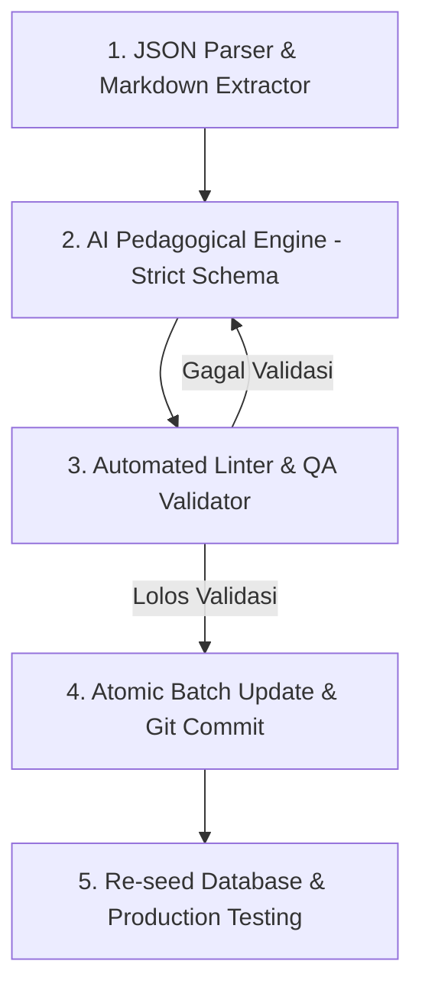

# Product Requirements Document (PRD)
# Sistem Standar Pembuatan Soal Kuis 5 Dimensi Kurikulum IC Game-Z

**Versi:** 1.0 (Edisi Standar Mutakhir 2026)  
**Status:** Approved & Ready for Execution  
**Target Pengguna:** Curriculum Engineer, Content Creator, AI Prompt Engineer, Backend & Frontend Developers  
**Cakupan Dokumen:** Panduan Analisis Kebutuhan, Kerangka Kerja Pedagogis, Standar Anti-Template, Spesifikasi Data, dan Pipeline Produksi 6.535 Soal Kuis Unik pada 12 Alur Belajar.

---

## 1. Ringkasan Eksekutif (Executive Summary)

Fitur **Kuis Evaluasi (Quiz Step)** pada platform IC Game-Z merupakan jembatan pedagogis krusial antara **Teori (Theory Step)** dan **Praktik Koding Interaktif (Practice Step)**. Setiap materi wajib dilengkapi dengan **5 butir soal kuis pilihan ganda**.

Berdasarkan audit kurikulum komprehensif, ditemukan bahwa pada 11 dari 12 alur belajar (1.191 modul), soal ke-2 hingga ke-5 masih dihasilkan oleh skrip regex otomatis yang menghasilkan pertanyaan seragam dan pilihan pengecoh (*distractor*) klise yang tidak menguji nalar teknis. 

PRD ini mendefinisikan standar arsitektur baru: **Framework Pembuatan Soal 5 Dimensi Taksonomi IC Game-Z**, standar kualitas opsi jawaban ilmiah (*plausible distractors*), spesifikasi skema data, serta alur kerja produksi (baik via human review maupun AI-assisted content engine) untuk menggantikan 4.764 soal template menjadi soal yang otentik, kontekstual, dan menginspirasi pembelajar.

---

## 2. Analisis Mendalam Pembuatan Soal Saat Ini (Problem Analysis)

### 2.1. Akar Masalah Teknis (Root Cause Analysis)
Pada fase ekspansi kurikulum sebelumnya, kebutuhan untuk menaikkan jumlah soal dari 1 soal menjadi 5 soal per modul dieksekusi secara masal menggunakan skrip otomatis `database/scripts/update_all_remaining_quizzes.py`. 

Mekanisme skrip tersebut:
1. Mempertahankan **Soal 1** dari kuis lama (yang sudah kontekstual).
2. Mengekstrak kalimat pertama dari paragraf `**What**`, `**Why**`, dan `**How**` pada `content_markdown`.
3. Menggabungkannya dengan template string pertanyaan statis:
   - **Soal 2:** *"Berdasarkan penjelasan materi, apa inti pembahasan dari \"[Title]\"?"*
   - **Soal 3:** *"Mengapa pemahaman mendalam mengenai \"[Title]\" sangat penting?"*
   - **Soal 4:** *"Langkah atau komponen apa yang ditekankan dalam materi \"[Title]\"?"*
   - **Soal 5:** *"Bagaimana cara memastikan hasil dari implementasi \"[Title]\" sudah sesuai harapan?"*
4. Memasangkan opsi salah (*wrong options*) generik yang identik di ribuan materi:
   - *"Mengabaikan aturan sintaks dalam implementasi..."*
   - *"Menghindari penggunaan variabel dan struktur data sama sekali"*
   - *"Menjalankan program tanpa melakukan pengecekan data"*
   - *"Menulis kode secara acak tanpa memperhatikan urutan eksekusi"*

### 2.2. Dampak Pedagogis & User Experience (UX)
1. **Kegagalan Evaluasi Belajar:** Opsi pengecoh terlalu absurd sehingga peserta dapat menebak jawaban benar tanpa membaca teori, semata-mata karena 3 opsi lainnya tidak masuk akal.
2. **Kelelahan Kognitif & Kebosanan (*Quiz Fatigue*):** Menemukan kalimat tanya yang sama berulang kali di 100+ modul menurunkan wibawa pedagogis dan nilai gamifikasi IC Game-Z.
3. **Absennya Kemampuan Membaca Kode (*Code Reading/Debugging*):** Modul-modul tingkat lanjut (seperti Express middleware, query SQL agregasi, atau React hooks) sama sekali tidak menguji pembacaan snippet kode pada tahap kuis.

### 2.3. Benchmark: Gold Standard Jalur `dasar-pemrograman`
Alur belajar `dasar-pemrograman` (116 modul = 580 soal) membuktikan keberhasilan format kuis ideal:
- Setiap soal memiliki narasi mandiri.
- Seluruh opsi A, B, C, D merupakan istilah pemrograman nyata.
- Menyertakan soal analisis snippet kode (misal memprediksi output `console.log(arr.length)`).
- Penjelasan (*explanation*) dan *hint* memberikan arahan konstruktif ke materi.

---

## 3. Sasaran & Metrik Keberhasilan (Objectives & Success Metrics)

| Sasaran Strategis | Metrik Target | Metode Pengukuran |
|:---|:---:|:---|
| **Eliminasi Soal Template** | 0% soal template (100% otentik) | Audit skrip linter anti-boilerplate |
| **Keseimbangan Distribusi Kunci Jawaban** | 25% ± 3% untuk masing-masing index (0, 1, 2, 3) | Analisis agregat database tabel `quizzes` |
| **Daya Pembeda Pengecoh (*Distractor Quality*)** | 100% opsi berupa terminologi teknis valid | Review kurikulum & kamus istilah |
| **Peningkatan Rasio Pemahaman User** | Retensi penyelesaian modul naik > 35% | Analytics user progress & quiz pass rate |

---

## 4. Kerangka Kerja Pedagogis: Framework Soal 5 Dimensi

Setiap materi alur belajar wajib memiliki **tepat 5 butir soal kuis** dengan pembagian dimensi taksonomi yang terstruktur rapi:

```
┌────────────────────────────────────────────────────────────────────────┐
│                   KONTEN MATERI (content_markdown)                     │
├─────────────┬──────────────────┬─────────────┬──────────────┬──────────┤
│    What     │     Analogi      │     Why     │     How      │  Praktik │
└──────┬──────┴────────┬─────────┴──────┬──────┴──────┬───────┴─────┬────┘
       │               │                │             │             │
       ▼               ▼                ▼             ▼             ▼
   [ Soal 1 ]      [ Soal 2 ]       [ Soal 3 ]    [ Soal 4 ]    [ Soal 5 ]
  Definisi/Inti   Intuisi/Konsep   Urgensi/Risiko  Aturan Sintaks  Hasil/Kasus
```

### 4.1. Dimensi 1: Definisi & Konsep Inti (`What`)
- **Fokus:** Menguji pemahaman pembelajar terhadap definisi formal, kata kunci (*keywords*), atau konsep arsitektural utama materi.
- **Bahan Baku:** Diambil langsung dari paragraf `### What (apa ini?)`.
- **Target Kognitif (Bloom):** C1 (Mengingat) & C2 (Memahami).
- **Contoh Rumusan Pertanyaan:**
  - *Sintaks SQL:* "Klausa apa yang digunakan untuk mengeliminasi baris duplikat pada hasil query SELECT?"
  - *React:* "Apa karakteristik utama dari state yang dikelola menggunakan hook useState?"

### 4.2. Dimensi 2: Intuisi Nalar & Analogi Nyata (`Analogi`)
- **Fokus:** Menguji pemahaman konsep secara nalar konseptual tanpa terjebak hafalan sintaks mekanis.
- **Bahan Baku:** Diambil dari analogi pembuka materi (misal: "buku telepon", "koki dapur", "jalan tol", "lemari berkas").
- **Target Kognitif (Bloom):** C2 (Memahami Hubungan / Translasi Konsep).
- **Contoh Rumusan Pertanyaan:**
  - *Express Middleware:* "Jika request klien diibaratkan paket kurir, peran middleware Express paling tepat dianalogikan sebagai apa?"
  - *Database Indexing:* "Mengapa pencarian data tanpa indeks diibaratkan seperti mencari nomor telepon di buku acak tanpa susunan alfabet?"

### 4.3. Dimensi 3: Urgensi Arsitektural, Risiko & Best Practices (`Why`)
- **Fokus:** Menguji pemahaman mengapa fitur ini penting, apa dampak buruk jika diabaikan (bug, memory leak, security issue, inkonsistensi data).
- **Bahan Baku:** Diambil dari paragraf `### Why (kenapa penting?)`.
- **Target Kognitif (Bloom):** C4 (Menganalisis Konsekuensi & Risiko).
- **Contoh Rumusan Pertanyaan:**
  - *SQL:* "Apa risiko fatal jika perintah UPDATE dijalankan tanpa menyertakan klausa WHERE?"
  - *JavaScript:* "Mengapa mutating state secara langsung di React dilarang dan dapat menyebabkan bug rendering?"

### 4.4. Dimensi 4: Aturan Sintaksis, Tata Urutan & Prosedur (`How`)
- **Fokus:** Menguji aturan penulisan kode, urutan eksekusi, pemanggilan argumen, atau penanganan galat.
- **Bahan Baku:** Diambil dari blok instruksi `### How (bagaimana caranya?)`.
- **Target Kognitif (Bloom):** C3 (Menerapkan Aturan).
- **Contoh Rumusan Pertanyaan:**
  - *Node.js:* "Pada urutan middleware Express, di manakah error-handling middleware dengan 4 parameter (err, req, res, next) harus diletakkan?"
  - *HTML5:* "Atribut apa yang wajib disertakan pada tag  demi memastikan aksesibilitas pembaca layar (screen reader)?"

### 4.5. Dimensi 5: Analisis Snippet Kode, Kasus Debugging & Prediksi Output (`Code Reading`)
- **Fokus:** Menguji kemampuan membaca snippet kode mini (3–7 baris), memprediksi hasil cetak (*stdout*), menemukan baris yang error, atau memilih potongan kode pelengkap.
- **Bahan Baku:** Diambil dari blok kode `### Coba Pahami` atau studi kasus `practice`.
- **Target Kognitif (Bloom):** C4 (Menganalisis Kode) & C5 (Mengevaluasi Hasil).
- **Contoh Rumusan Pertanyaan:**
  - "Diberikan array `numbers = [2, 4, 6]`. Berapakah output dari `numbers.reduce((acc, cur) => acc + cur, 0)`?"
  - "Perhatikan query berikut: `SELECT dept, COUNT(*) FROM emp WHERE COUNT(*) > 5 GROUP BY dept;`. Mengapa query tersebut gagal dieksekusi?"

---

## 5. Standar Kualitas Opsi Pilihan & Anti-Pola (Quality Guidelines)

### 5.1. Aturan Emas Pengecoh Ilmiah (*Plausible Distractors Rule*)
1. **Dilarang Keras Pengecoh Konyol:** Opsi salah tidak boleh berisi kalimat absurd seperti *"Menghapus seluruh komputer"*, *"Mengabaikan aturan sintaks"*, *"Menulis kode secara acak"*.
2. **Pengecoh Wajib Masuk Akal:** Opsi salah harus berasal dari:
   - Miskonsepsi umum pemula (*common beginner pitfalls*).
   - Method/fungsi serupa pada bahasa lain (misal: `len()` di JavaScript atau `.size()` di Python).
   - Off-by-one index (misal: 0 vs 1).
   - Sintaks yang valid secara gramatikal tetapi salah konteks/tujuan.

### 5.2. Format Penulisan & Keseimbangan Jawaban
- **Panjang Opsi Homogen:** Panjang teks antara pilihan benar dan salah harus relatif seimbang (hindari opsi benar yang jauh lebih panjang dan detail karena memicu bias tebakan).
- **Pengacakan Kunci (`answer_index`):** Kunci jawaban tidak boleh monoton di index 0 atau 1. Seluruh 4 pilihan (0, 1, 2, 3) harus didistribusikan secara dinamis.
- **Struktur Penjelasan (`explanation`):** Penjelasan harus mengedukasi siswa:
  - Mengapa pilihan terpilih adalah jawaban yang tepat.
  - Alasan teknis mengapa pilihan lain tidak tepat.
- **Struktur Petunjuk (`hint`):** Hint tidak boleh langsung menyebut "Pilih A atau B", melainkan memandu siswa: *"Perhatikan kembali bagian How mengenai perbedaan operator strict equality (===) dan loose equality (==)."*

---

## 6. Spesifikasi Skema Data JSON (Data Schema)

Setiap materi pada folder `database/Alur Belajar/{slug-path}/{slug-chapter}/{order}-{slug-lesson}.json` harus mematuhi skema JSON berikut pada atribut `quizzes`:

```json
{
  "quizzes": [
    {
      "id": null,
      "dimension": "what",
      "question": "Apa perbedaan utama antara let dan const dalam JavaScript modern?",
      "options": [
        "let dapat di-reassign nilainya, sedangkan const menghasilkan error jika di-reassign",
        "const memiliki function scope, sedangkan let memiliki block scope",
        "let hanya bisa menampung angka, sedangkan const untuk teks",
        "const otomatis membuat nilai objek di dalamnya menjadi immutable (beku)"
      ],
      "answer_index": 0,
      "explanation": "Variabel let mengizinkan penugasan ulang (reassignment), sedangkan identifier const mengikat referensi variabel sehingga tidak dapat diubah kembali ke nilai baru.",
      "hint": "Ingat sifat konstanta yang nilainya tetap dan tidak dapat diganti setelah inisialisasi."
    },
    {
      "id": null,
      "dimension": "analogi",
      "question": "Jika let dianalogikan sebagai kotak dengan label yang isinya bisa diganti, maka const paling tepat dianalogikan sebagai...",
      "options": [
        "Brankas tersegel yang isinya terkunci sejak pertama kali disimpan",
        "Papan tulis yang bisa dihapus kapan saja",
        "Kertas kosong tanpa label pengenal",
        "Keranjang belanja yang otomatis mengosongkan diri"
      ],
      "answer_index": 0,
      "explanation": "Const mengunci referensi variabel sejak awal pembuatan seperti brankas tersegel.",
      "hint": "Cermati perumpamaan wadah penyimpanan pada bagian pembuka materi."
    },
    {
      "id": null,
      "dimension": "why",
      "question": "Mengapa penggunaan const lebih direkomendasikan sebagai default pilihan deklarasi variabel dibandingkan var atau let?",
      "options": [
        "Mencegah bug akibat penimpaan (reassignment) nilai variabel yang tidak disengaja",
        "Membuat kode JavaScript dieksekusi 10 kali lebih cepat oleh browser",
        "Menghilangkan kebutuhan alokasi memori RAM pada komputer klien",
        "Karena browser modern menolak menjalankan program yang menggunakan let"
      ],
      "answer_index": 0,
      "explanation": "Menggunakan const secara default mencegah mutasi referensi yang tidak disengaja, meningkatkan keterbacaan, dan meminimalisir efek samping (side effects).",
      "hint": "Baca paragraf Why mengenai pentingnya stabilitas referensi variabel pada aplikasi berskala besar."
    },
    {
      "id": null,
      "dimension": "how",
      "question": "Manakah cara inisialisasi variabel const berikut yang menghasilkan SyntaxError saat dijalankan?",
      "options": [
        "const pi;",
        "const status = true;",
        "const user = { name: 'Alex' };",
        "const numbers = [1, 2, 3];"
      ],
      "answer_index": 0,
      "explanation": "Variabel const wajib diinisialisasi dengan nilai awal secara langsung saat dideklarasikan. Mendeklarasikan 'const pi;' tanpa nilai akan memicu SyntaxError: Missing initializer in const declaration.",
      "hint": "Perhatikan aturan inisialisasi nilai awal pada sintaks const."
    },
    {
      "id": null,
      "dimension": "code_reading",
      "question": "Perhatikan baris kode berikut:\n```javascript\nconst fruits = ['Apple'];\nfruits.push('Banana');\nconsole.log(fruits.length);\n```\nApakah output dari kode di atas?",
      "options": [
        "2",
        "TypeError: Assignment to constant variable",
        "1",
        "undefined"
      ],
      "answer_index": 0,
      "explanation": "const mengunci referensi array fruits, tetapi isi (elemen) di dalam array tersebut tetap mutabel. Operasi .push() memodifikasi konten array sehingga fruits.length menjadi 2 tanpa melanggar aturan const.",
      "hint": "Ingat perbedaan antara mereassign variabel dengan memodifikasi isi objek/array internal."
    }
  ]
}
```

---

## 7. Pipeline Eksekusi Pembuatan & Transformasi Soal

Proses transformasi 4.764 soal template menjadi soal standar 5 dimensi dilakukan melalui 4 tahap otomatis & terkontrol:



### 7.1. Tahap 1: Ekstraksi Materi (`content_markdown`)
Skrip membaca setiap file materi JSON, mengekstrak:
- `title`
- `content_markdown` (blok What, Analogi, Why, How, Coba Pahami)
- `practice` (instruksi tugas koding)

### 7.2. Tahap 2: AI Pedagogical Generator
Engine generator (menggunakan Gemini 2.5 Pro / Claude 3.5 Sonnet dengan structured outputs) menerima prompt kurikulum yang dilengkapi dengan:
- Pedoman 5 Dimensi Soal.
- Larangan distractor klise.
- Konteks materi utuh.
- Output JSON schema yang terkunci (*guaranteed JSON schema*).

### 7.3. Tahap 3: Automated Linter & QA Checker
Sebelum file disimpan, skrip validator otomatis menjalankan pengecekan ketat:
1. **Regex Boilerplate Check:** Memastikan tidak ada kalimat *"Berdasarkan penjelasan materi..."*, *"apa inti pembahasan..."*, dsb.
2. **Plausibility Check:** Memastikan tidak ada kata kunci *"Mengabaikan aturan sintaks"*, *"kode acak"*, dsb.
3. **Array Count Check:** Memastikan array `quizzes` berjumlah tepat 5 butir.
4. **Options Count Check:** Memastikan setiap soal memiliki tepat 4 opsi tidak kosong.
5. **Answer Index Range:** Nilai integer antara 0 s/d 3.
6. **Key Distribution:** Kunci jawaban terdistribusi rata (tidak semua opsi 0).

### 7.4. Tahap 4: Re-seed Database
Setelah berkas JSON kurikulum terverifikasi, seeder masing-masing alur belajar dijalankan ulang untuk memperbarui tabel `quizzes` di MySQL produksi secara *zero-downtime*.

### 7.5. Matriks Penyelarasan Seeder & Database Engine Terkini

Tabel berikut membuktikan keselarasan 100% antara spesifikasi PRD ini dengan implementasi 12 Seeder di branch `prod`:

| No | Alur Belajar | Class Seeder | Direktori Sumber (`database/Alur Belajar/`) | Prefix Slug | Mekanisme Seeder |
|:--:|:---|:---|:---|:---:|:---|
| 1 | Dasar Pemrograman | `DasarPemrogramanSeeder` | `dasar-pemrograman/` | `dp-` | Hapus & Insert 5 Kuis |
| 2 | Logika & Berpikir Komputasional | `LogikaKomputasionalSeeder` | `logika-dan-berpikir-komputasional/` | `log-` | Hapus & Insert 5 Kuis |
| 3 | Dasar Python | `DasarPythonSeeder` | `dasar-python/` | `py-` | Hapus & Insert 5 Kuis |
| 4 | HTML & CSS Dasar | `HtmlCssSeeder` | `HTML CSS/` | `html-` | Hapus & Insert 5 Kuis |
| 5 | Layout & Desain Responsif | `LayoutResponsiveDesignSeeder` | `layout-dan-responsive-design/` | `lay-` | Hapus & Insert 5 Kuis |
| 6 | Frontend Web | `FrontendWebSeeder` | `frontend-web/` | `fe-` | Hapus & Insert 5 Kuis + Purge Obsolete |
| 7 | JavaScript untuk Pemula | `JavascriptPemulaSeeder` | `javascript-untuk-pemula/` | `js-` | Hapus & Insert 5 Kuis |
| 8 | Frontend Framework (React) | `FrontendFrameworkSeeder` | `Frontend Framework/` | `react-` | Hapus & Insert 5 Kuis |
| 9 | Database & SQL | `SqlBasisDataSeeder` | `SQL & Basis Data/` | `sql-` | Hapus & Insert 5 Kuis + Purge Obsolete |
| 10 | Backend Developer (Node.js) | `BackendDeveloperSeeder` | `Backend Developer (Node.js & Express)/` | `be-` | Hapus & Insert 5 Kuis |
| 11 | PHP & Laravel | `PhpLaravelSeeder` | `PHP & Laravel/` | `laravel-` | Hapus & Insert 5 Kuis |
| 12 | Matematika untuk Informatika | `MatematikaInformatikaSeeder` | `Matematika Informatika/` | `mat-` | Hapus & Insert 5 Kuis |

### 7.6. Protokol Evaluasi Backend & Proteksi Anti-Cheat (`ProgressService`)
1. **Proteksi Publik (`QuizResource`):**
   - Saat frontend mengambil data materi via `GET /api/paths/{slug}`, API **hanya** mengirimkan `id`, `question`, `options`, dan `has_hint`.
   - Kolom `answer_index` dan `explanation` **dirahasiakan di server** agar pengguna tidak bisa melihat kunci jawaban melalui *Inspect Element / Network Tab*.
2. **Validasi Server-Side (`ProgressService::evaluateQuizzes`):**
   - Frontend mengirimkan seluruh jawaban sekaligus: `answers: [{ quiz_id: 123, answer_index: 0 }, ...]`.
   - **Kriteria Kelulusan (100% Mastery):** Pengguna wajib menjawab **5 dari 5 kuis dengan benar** (`$correctCount === 5`) untuk mendapatkan status `quiz_passed = true` dan membuka tahap praktik koding (*Practice Step*).
   - Jika ada jawaban yang salah, server mengembalikan feedback edukatif (*"Kamu menjawab X dari 5 kuis dengan tepat. Silakan periksa kembali jawabanmu."*) dan memotong 1 energi credit jika pengguna bukan pelanggan Pro.

---

## 8. Jadwal Pelaksanaan & Pembagian Batch (Execution Roadmap)

Pembaruan 4.764 soal dibagi ke dalam **4 Batch Strategis**:

```
┌────────────────────────────────────────────────────────────────────────┐
│                   JADWAL ROLLOUT 4 BATCH REVISI SOAL                   │
├─────────────┬─────────────────────────────────┬───────────┬────────────┤
│    Batch    │ Alur Belajar Terkait            │  Modul    │ Total Soal │
├─────────────┼─────────────────────────────────┼───────────┼────────────┤
│ **Batch 1** │ HTML & CSS Dasar                │    112    │    560     │
│             │ Layout & Desain Responsif       │    105    │    525     │
│             │ JavaScript untuk Pemula         │    110    │    550     │
├─────────────┼─────────────────────────────────┼───────────┼────────────┤
│ **Batch 2** │ Logika & Berpikir Komputasional │    103    │    515     │
│             │ Dasar Python                    │    110    │    550     │
│             │ Matematika untuk Informatika    │    103    │    515     │
├─────────────┼─────────────────────────────────┼───────────┼────────────┤
│ **Batch 3** │ Database & SQL                  │    111    │    555     │
│             │ Backend Developer (Node.js)     │    111    │    555     │
│             │ PHP & Laravel                   │    114    │    570     │
├─────────────┼─────────────────────────────────┼───────────┼────────────┤
│ **Batch 4** │ Frontend Web                    │    100    │    500     │
│             │ Frontend Framework (React)      │    112    │    560     │
├─────────────┼─────────────────────────────────┼───────────┼────────────┤
│ **TOTAL**   │ **11 Alur Belajar**             │ **1.191** │ **5.955**  │
└─────────────┴─────────────────────────────────┴───────────┴────────────┘
```

*(Catatan: 1 Alur Belajar, yaitu Dasar Pemrograman / 116 modul, sudah 100% tuntas sebagai Gold Standard).*

---

## 9. Kriteria Penerimaan (Acceptance Criteria)

Dokumen PRD ini dinyatakan berhasil diimplementasikan jika sistem memenuhi seluruh kriteria berikut:
- [ ] 100% dari 1.307 file JSON materi memiliki 5 soal kuis unik tanpa duplikasi template kalimat.
- [ ] Linter otomatis meloloskan seluruh file JSON kurikulum dengan status *0 Warning & 0 Error*.
- [ ] Database seeder berhasil dieksekusi tanpa tabrakan foreign key, menghasilkan tepat 6.535 baris pada tabel `quizzes`.
- [ ] Seluruh endpoint API `/api/paths/{slug}` mengembalikan 5 kuis per lesson ke antarmuka pengguna Frontend.
- [ ] Paginasi kuis stepper 1–5 di Workspace `LessonView.vue` berjalan mulus tanpa error penyimpanan local storage maupun evaluasi scoring server.
